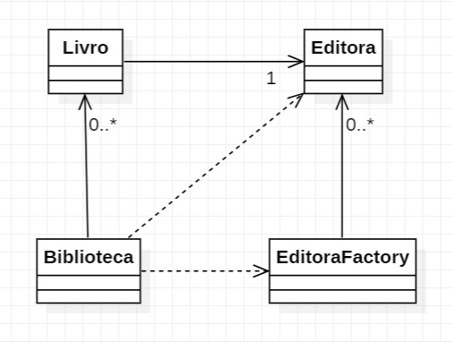

# Exercício Flyweight, Acervo de Biblioteca
#### Nome: João Vitor Fernandes Ribeiro Carneiro Ramos
#### Matrícula: 202165076C

Implementação do padrão de projeto **Flyweight** em Java.

## Diagrama UML

